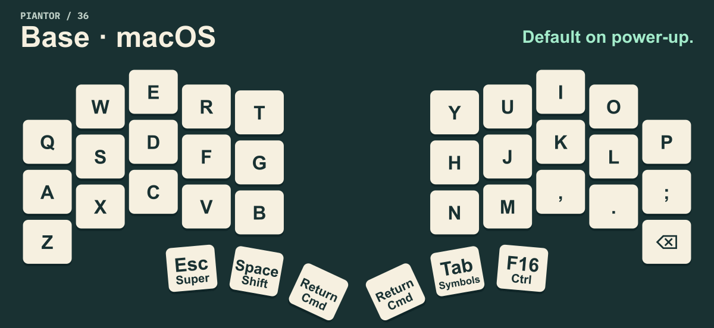

# Eduardo's QMK userspace

My Piantor is my daily driver. My 36-key Corne runs the same QMK keymap. The MacBook
keyboard mirrors it with
[Karabiner-Elements](https://github.com/eduarbo/dotfiles/tree/main/macos/karabiner).

**[Find a key or shortcut](users/eduarbo/README.md#find-a-key)** · [Split and MacBook thumbs](users/eduarbo/README.md#base-and-thumbs) · [All layer maps](users/eduarbo/README.md#layers) · [Build and flash](users/eduarbo/README.md#build-and-flash)

<picture>
  <source media="(max-width: 600px) and (prefers-reduced-motion: reduce)" srcset="docs/cover/layout-mobile.webp">
  <source media="(prefers-reduced-motion: reduce)" srcset="docs/cover/layout.webp">
  <source media="(max-width: 600px)" srcset="docs/cover/layout-mobile.gif">
  
</picture>

[Read the five gestures at your own pace](users/eduarbo/README.md#the-demo-at-your-own-pace)

| Target | Hardware |
| --- | --- |
| `beekeeb/piantor:eduarbo` | Raspberry Pi Pico (RP2040), one UF2 per half |
| `crkbd/rev1:eduarbo` | Pro Micro (AVR), OLED on, RGB Matrix off |

[`qmk.json`](qmk.json) lists both targets for `qmk userspace-compile`. Running the
**Build QMK firmware** workflow in GitHub Actions builds them and replaces the `latest`
release only when both compile.
