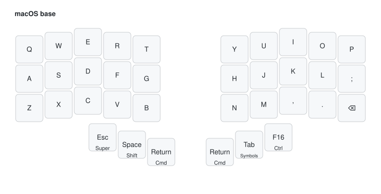
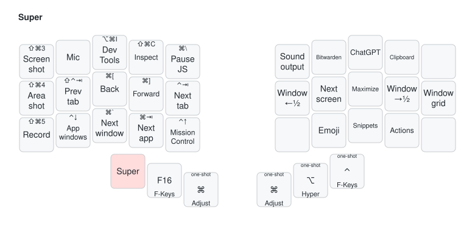
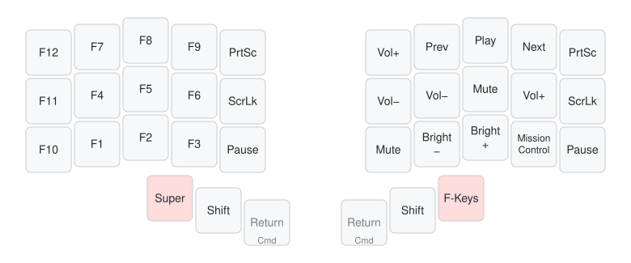
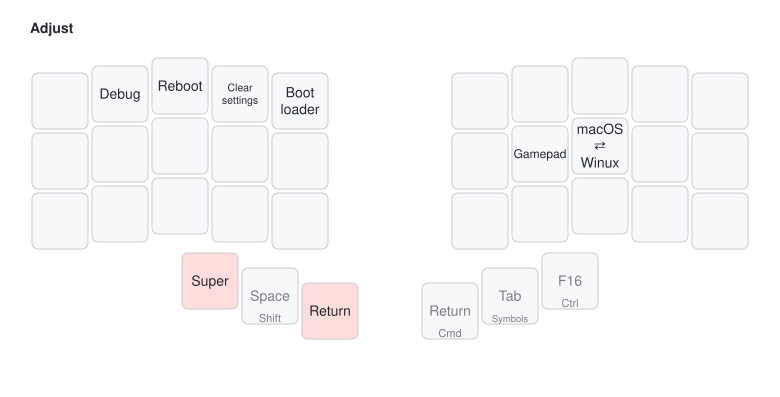

# Eduardo's 36-key layout

One layout for the [Piantor](https://github.com/beekeeb/piantor) and the 3×5 Corne,
mirrored on the MacBook keyboard by
[Karabiner-Elements](https://github.com/eduarbo/dotfiles/tree/main/macos/karabiner).
Both boards build from this userspace with the same keymap.

- **Thumbs do double duty:** tap for a key, hold for a modifier or a layer.
- **Always boots into macOS:** Winux is a per-session switch, and reconnecting restores macOS.
- **Parity is tested:** `npm test` in `dotfiles/macos/karabiner` checks the base, Symbols and
  F-Keys layers against [`wrappers.h`](wrappers.h).

## Layers

Highlighted keys are held to reach the layer; dimmed keys fall through to the base layer.

### macOS base



### Winux base

The same keys with Control and GUI swapped on the thumbs. Switch with **macOS ⇄ Winux**
on Adjust.



### Symbols · hold Tab



- `´` and `˜` tap the dead keys (`Option+E`/`Option+N`, or `Right Alt` on Winux). Held, they
  act as Shift without leaving the layer.
- Shift turns PgUp and PgDn into Home and End.
- Thumb taps add a modifier: `⇧ Esc`, `⇧ Space` and `⌘ Return` (`Ctrl+Return` on Winux).

### Super · hold Esc

Super is `⌘⌥⌃`. The small legend shows the shortcut each key sends.



- QMK sends `E`, `R`, `T`, `S`, `D`, `F` and `G` itself, as Control shortcuts on Winux.
  Karabiner maps `Q`, `A`, `Z`, `X`, `C`, `V` and `B`, and
  [Hammerspoon](https://github.com/eduarbo/dotfiles/tree/main/macos/hammerspoon) and Raycast
  bind the right hand, so those need macOS with the dotfiles installed.
- **Hyper** (`⌘⌥⌃⇧`): hold Super and Symbols in either order. Every key tapped while both
  are held gets Hyper; releasing one leaves only the other. Hammerspoon uses it to
  [launch apps](https://github.com/eduarbo/dotfiles/tree/main/macos/hammerspoon#app-launcher).
- Tapping a Return, Tab or Fn thumb sends its modifier once (one-shot).

### F-Keys · hold Super, then Space or the right Fn thumb



Key for key the same as the Karabiner FN layer.

### Adjust · hold Super and a Return thumb



- **macOS ⇄ Winux** switches the base until the keyboard is reconnected.
- **Gamepad** toggles the gaming layer.
- **Bootloader** prepares the half for flashing, so you don't need the BOOTSEL button.
- **Clear settings** erases the EEPROM. On the Piantor that includes which side the half
  is, so reflash it with its `-left` or `-right` target afterwards.

### Gamepad



The arrows sit where WASD would be, shifted one column right. To leave, hold Alt and the
right Return thumb to reach Adjust, then tap **Gamepad**.

### Caps Word

`Symbols+Z` turns on QMK Caps Word. Letters are capitalized, while digits, `-`, `'`, `;`, `` ` ``,
Backspace and Delete continue it unshifted, as with Caps Lock. It is the only deliberate
difference from Karabiner, which sends Caps Lock. Both sides use a 250 ms tap window.

## Why it looks like this

- Super and Shift sit on the left, so shortcuts work one-handed while the right hand is on
  the mouse.
- Symbols sits on the right, so the arrows on `H`, `J`, `K` and `L` work with one hand.
- Return and Command sit on both sides, like the MacBook space bar, so they pair with a
  modifier on either hand.
- Return stays off the Shift and Symbols thumbs to avoid accidental presses while typing.

## Build and flash

Without a global `qmk` install, run the CLI through `uv` with the QMK toolchains on the
`PATH`, from the root of this repository:

```sh
export PATH="$HOME/dev/eduarbo/qmk_toolchains/bin:$PATH" QMK_HOME=~/dev/eduarbo/qmk_firmware
alias qmk='uvx --from qmk==1.2.0 qmk'
```

| Task | Command |
| --- | --- |
| Build both boards | `qmk userspace-compile` |
| Flash a Piantor half | `qmk flash -kb beekeeb/piantor -km eduarbo -bl uf2-split-left` (or `-right`) |
| Flash a Corne half | `qmk flash -kb crkbd/rev1 -km eduarbo -bl avrdude-split-left` (or `-right`) |

When the CLI waits for the board, connect that half and choose **Bootloader** on Adjust,
or hold BOOTSEL while plugging it in. Each half stores its side in EEPROM (`EE_HANDS`), so
flash it with the matching `-left` or `-right` target.

The AVR-based Corne keeps its OLED and disables RGB Matrix to fit; it uses about 96% of
its flash, so compile both boards before accepting a change.

## Update the diagrams

```sh
python3 docs/draw_layout.py
```

The script reads `wrappers.h` and redraws `docs/layers/*.svg` with a pinned
[keymap-drawer](https://github.com/caksoylar/keymap-drawer). Labels and the Super layer,
which lives in `process_records.c` and Karabiner rather than `wrappers.h`, are defined in
the script.

## Test after flashing

1. Tap and hold `´` and `˜` on Symbols: the tap types the accent, the hold shifts the
   next Symbols key.
2. Tap and hold each thumb on Symbols and on both bases, releasing in both orders; no
   modifier may stay latched.
3. Hold a Return thumb and tap Space: it opens Spotlight on macOS.
4. Hold Hyper in both press orders and tap several keys; each must get Hyper.
5. Hold Super, then tap and hold Space; release in both orders.
6. On F-Keys, `J`, `K` and `L` send Volume Down, Mute and Volume Up.
7. Turn on Caps Word and type `ABC-DEF`; the hyphen must stay a hyphen.
8. Switch to Winux on Adjust, then reconnect the keyboard: it must be back on macOS.
