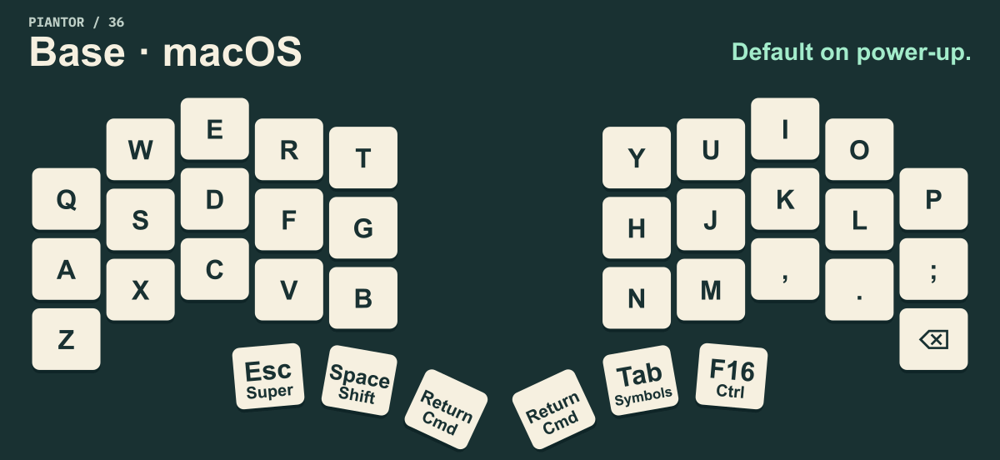
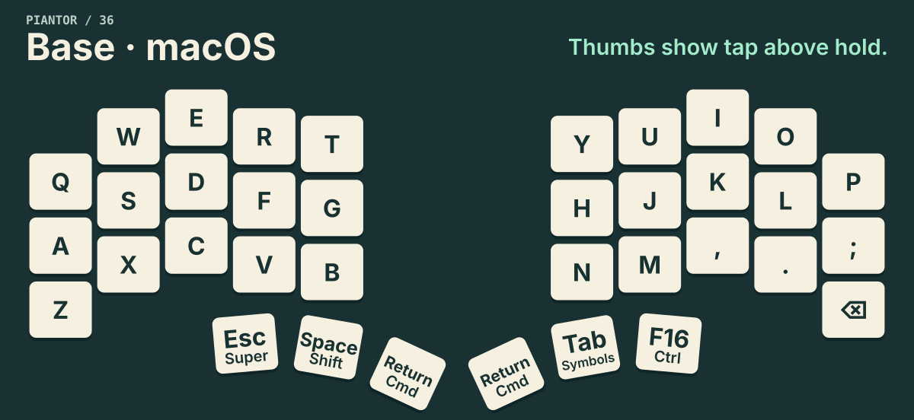
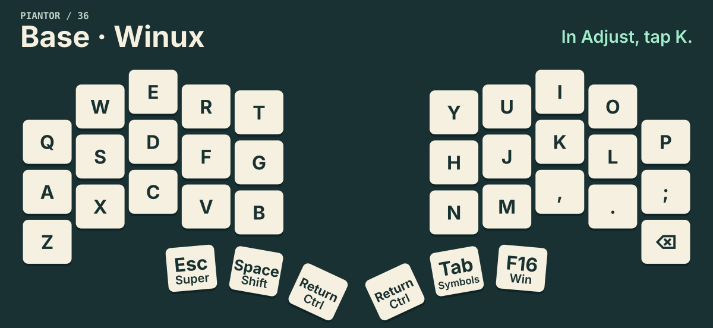
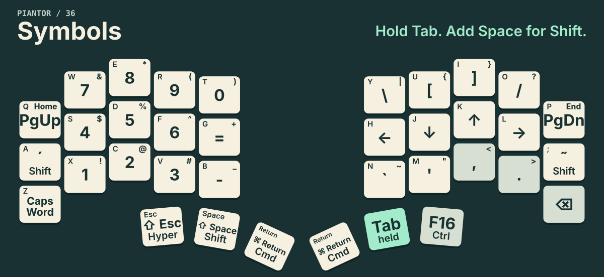
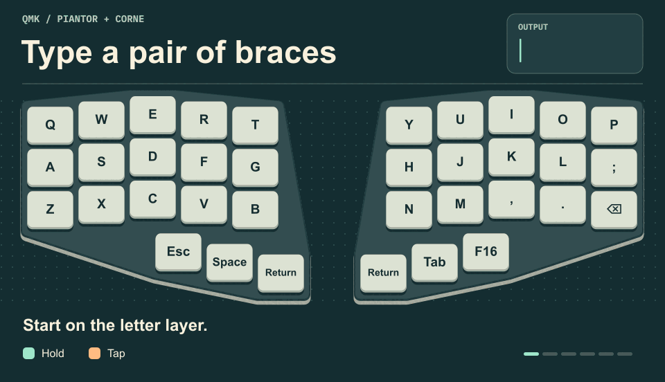
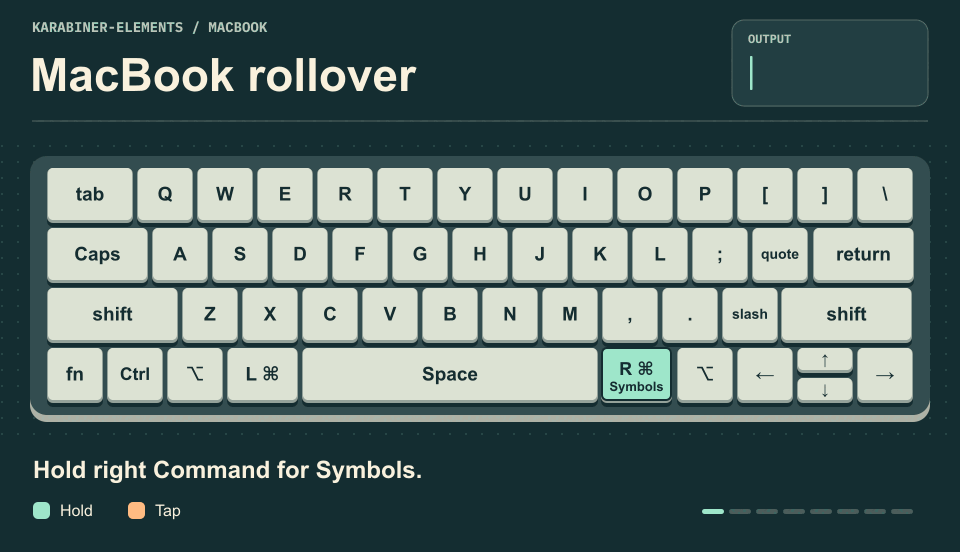
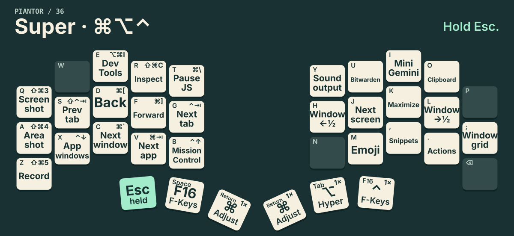
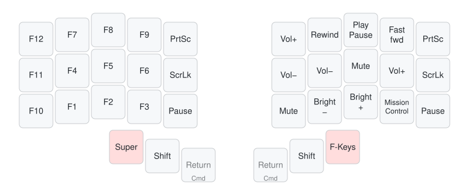
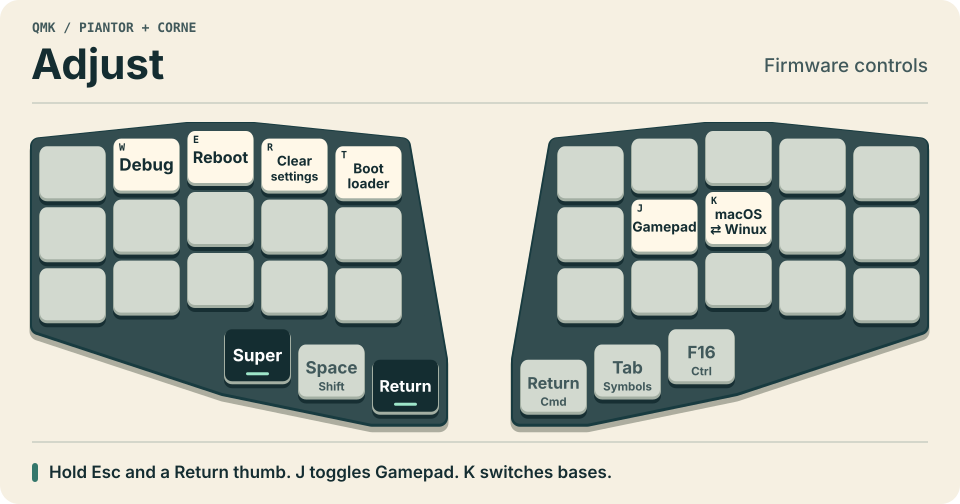
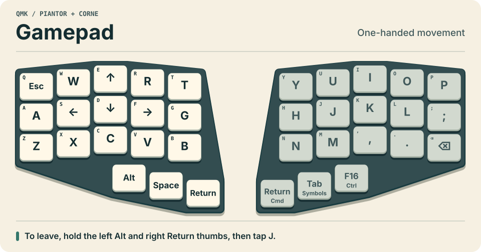

# Eduardo's 36-key layout

[Find a key](#find-a-key) · [Base and thumbs](#base-and-thumbs) · [Layer maps](#layers) · [Build and flash](#build-and-flash)

<picture>
  <source media="(max-width: 600px) and (prefers-reduced-motion: reduce)" srcset="../../docs/cover/layout-mobile.webp">
  <source media="(prefers-reduced-motion: reduce)" srcset="../../docs/cover/layout.webp">
  <source media="(max-width: 600px)" srcset="../../docs/cover/layout-mobile.gif">
  
</picture>

The [Piantor](https://github.com/beekeeb/piantor) is my daily driver. My 3×5 Corne and MacBook use the same finger positions. I keep the arrows on `H J K L` so I can move the cursor with my right hand, and put my browser shortcuts on the left so I can keep the other hand on the mouse. The splits run QMK. On the laptop, Karabiner-Elements gives the keys around the space bar the jobs of the six split thumbs.

## Find a key

Letters below name the physical QWERTY positions. Character examples use U.S. input.

| When a recipe says… | Hold on the Piantor or Corne | Hold on the MacBook |
| --- | --- | --- |
| **Shift** | **Space** · left middle thumb | **Left ⌘** |
| **Symbols** | **Tab** · right middle thumb | **Right ⌘** |
| **Super** | **Esc** · left outer thumb | **Left ⌥** |

| I want to… | What to press |
| --- | --- |
| Type `[ ]` or `{ }` | Hold Symbols and tap `U` for `[` or `I` for `]`. For `{` or `}`, hold **Symbols + the Space/Shift thumb**, then tap the same key. |
| Type `-` or `_` | Hold Symbols and tap `B`. For `_`, add the **Shift thumb** before tapping `B`. |
| Type `á` or `ñ` on macOS | Hold Symbols, tap `A` for acute or `;` for tilde, release Symbols, then type the letter. |
| Type a number | Hold Symbols. `X C V` give **1 2 3**, `S D F` give **4 5 6**, `W E R` give **7 8 9**, and `T` gives **0**. |
| Move the cursor | Hold Symbols. `H J K L` give **← ↓ ↑ →**. `Q` / `P` give **Page Up / Page Down**. Add the **Shift thumb** for **Home / End**. |
| Send ⌘Return | Hold Symbols. Tap either **Return thumb** on the split or the **physical space bar** on the MacBook. |
| Send ⌘Space for Spotlight | On the split, hold either **Return thumb** and tap the **Space thumb**. On the MacBook, hold the **physical space bar** and tap **left ⌘**. |
| Go back / forward in the browser | Hold Super and tap `D` / `F`. For previous / next tab, use `S` / `G`. |
| Press F5 or mute the audio | On the split, hold **Esc**, then hold the **Space thumb**. On the MacBook, hold **left ⌥**, then hold the **space bar**. Tap `D` for **F5** or `K` for **mute**. |
| Open Finder with my app launcher | Hold Super and Symbols together, then tap `F`. [All launcher bindings](https://github.com/eduarbo/dotfiles/tree/main/macos/hammerspoon#app-launcher) |

You can also [look up every punctuation pair on Symbols](#symbols--hold-tab) or read [why I added two spare Shifts for MacBook rollover](#macbook-rollover-and-shift).

## Layers

| Hold to reach | Piantor / Corne | MacBook · printed keys |
| --- | --- | --- |
| Symbols | Tab thumb | Right ⌘ |
| Super · ⌘⌥⌃ | Esc thumb | Left ⌥ |
| Hyper · ⌘⌥⌃⇧ | Esc + Tab thumbs, either order | Left ⌥ + right ⌘, either order |
| F-Keys | Esc first, then Space or F16 thumb | Left ⌥ first, then space bar or right ⌥ |
| Adjust | Esc + either Return thumb | QMK only |
| Gamepad | On Adjust, tap `J` to toggle | QMK only |

### Base and thumbs

<picture>
  <source media="(max-width: 600px)" srcset="../../docs/layers/mobile/macos.svg">
  
</picture>

| Split key | MacBook keycap | Tap | Hold · macOS |
| --- | --- | --- | --- |
| Left outer | Left ⌥ | Esc | Super |
| Left middle | Left ⌘ | Space | Shift |
| Either inner | Space bar | Return | Right ⌘ |
| Right middle | Right ⌘ | Tab | Symbols |
| Right outer | Right ⌥ | F16 | Right Control |

Both configurations use a 250 ms tap window. In QMK, pressing a second key also selects the hold action. Both inner thumbs are Return so I can hit Enter with either hand. Keeping Return off the Shift and Symbols thumbs saves me accidental newlines. On the MacBook the printed `/` takes the split's Backspace position.

<details>
<summary>See the printed keys on the MacBook</summary>

<picture>
  <source media="(max-width: 600px)" srcset="https://raw.githubusercontent.com/eduarbo/dotfiles/main/macos/karabiner/docs/macbook-mobile.svg">
  
</picture>

On the keyboard drawing, the top legend is the printed keycap. Read the middle for its tap and the bottom for its hold.

</details>

<details>
<summary>Winux base · Windows and Linux on QMK</summary>

On Adjust, tap `K` for Winux. The Return thumbs now hold **right Ctrl**, and the F16 thumb holds **right GUI** (Windows/Super). Symbols + Return sends **Ctrl+Return**. The accent taps send **Right Alt+E** and **Right Alt+N**. Your OS input layout determines what those produce. Powering the keyboard back on restores the macOS base.

<picture>
  <source media="(max-width: 600px)" srcset="../../docs/layers/mobile/winux.svg">
  
</picture>

</details>

### Symbols · hold Tab

Hold the **Tab thumb** to enter Symbols. Read the small upper-left legend for the physical key, the center for its tap, and the upper right for what you get with the **Space/Shift thumb** held. Dimmed keys inherit their base action.

<picture>
  <source media="(max-width: 600px)" srcset="../../docs/layers/mobile/symbols.svg">
  
</picture>

<details>
<summary>Look up punctuation by character</summary>

Hold Symbols throughout. To get the last column, also hold the **Space/Shift thumb** (printed **left ⌘** on the MacBook).

| Physical position | Tap | With Shift |
| --- | --- | --- |
| `X C V` | `1 2 3` | `! @ #` |
| `S D F` | `4 5 6` | `$ % ^` |
| `W E R T` | `7 8 9 0` | `& * ( )` |
| `G` / `B` | `=` / `-` | `+` / `_` |
| `U` / `I` | `[` / `]` | `{` / `}` |
| `Y` / `O` | <code>&#92;</code> / `/` | <code>&#124;</code> / `?` |
| `N` / `M` | <code>&#96;</code> / `'` | `~` / `"` |
| `,` / `.` | `,` / `.` | `<` / `>` |

For a literal `~`, hold both thumbs and tap `N`. For `:`, stay on the **base**, hold the Shift thumb and tap `;`.

</details>

**Thumb taps on Symbols.** Tap Esc for **⇧Esc**, Space for **⇧Space**, or Return for **⌘Return** on macOS. Use the [base thumb table](#base-and-thumbs) to find their physical MacBook keys.

**Caps Word.** Symbols + `Z` toggles QMK Caps Word. Try `ABC-123` followed by a space. Digits, hyphen, apostrophe, semicolon, grave, Backspace and Delete keep it going unshifted. Space ends the word. Karabiner uses the same position for **Caps Lock**. Tap it again to switch it off.

#### Type a pair of braces

Hold **Tab** with your right thumb and **Space** with your left. Tap **U** for `{` and **I** for `}`, then release both thumbs. On the MacBook, the same gesture uses the printed **right ⌘** for Symbols and **left ⌘** for Shift.

<picture>
  <source media="(max-width: 600px) and (prefers-reduced-motion: reduce)" srcset="../../docs/layers/mobile/symbols.svg">
  <source media="(prefers-reduced-motion: reduce)" srcset="../../docs/layers/symbols.svg">
  <source media="(max-width: 600px)" srcset="../../docs/gestures/split-braces-mobile.gif">
  
</picture>

[Open the braces GIF](../../docs/gestures/split-braces.gif)

#### MacBook rollover and Shift

On my MacBook's built-in keyboard, some combinations of physical keys held together don't all register. With full **N-key rollover (NKRO)**, every held key registers even as I press another. Karabiner can only remap the events the keyboard actually sends. I ran into this trying to hold my usual Shift and Symbols while typing a third key.

If a chord drops a key, I keep **right ⌘** down for Symbols and move Shift from **left ⌘** to **A** or **;**. That changes which physical keys the keyboard has to register. These two extra holds send **left Shift**. A tap still gives me the accent I need for Spanish. I kept the same tap/hold behavior on the splits.

<picture>
  <source media="(prefers-reduced-motion: reduce)" srcset="../../docs/symbols-tap-hold.svg">
  <source media="(max-width: 600px)" srcset="../../docs/gestures/macbook-symbols-mobile.gif">
  
</picture>

[Open the MacBook GIF](../../docs/gestures/macbook-symbols.gif) · [Still tap/hold sequence](../../docs/symbols-tap-hold.svg)

| While holding Symbols | Tap for an accent | Rollover workaround · hold as Shift |
| --- | --- | --- |
| `A` · left pinky | Acute dead key · release Symbols, then `E` gives **é** | Tap `U` for **{** or `I` for **}** |
| `;` · right pinky | Tilde dead key · release Symbols, then `N` gives **ñ** | Tap `B` for **_** or `W` for **&** |

On the MacBook **base**, I also have dedicated Shifts at **Caps Lock** (left Shift) and the **quote key** (right Shift). [MacBook keycap map](https://github.com/eduarbo/dotfiles/tree/main/macos/karabiner)

### Super · hold Esc

<picture>
  <source media="(max-width: 600px)" srcset="../../docs/layers/mobile/super.svg">
  
</picture>

| What I use it for | Super + key |
| --- | --- |
| Browser devtools · inspector · pause JS | `E` · `R` · `T` |
| Full screenshot · area screenshot · capture toolbar | `Q` · `A` · `Z` with Karabiner |
| Left half · next display · maximize · right half · window grid | `H` · `J` · `K` · `L` · `;` with Hammerspoon |

QMK emits the seven browser shortcuts (`E R T S D F G`) in firmware. On Winux, back/forward use **Alt+←/→**. Screenshot and app-switching keys (`Q A Z X C V B`) use a device-independent Karabiner rule, so the splits get them on my Mac too. Right-hand window and utility bindings depend on my Hammerspoon, Raycast or Gemini setup. The thumb legends on the Super diagram describe QMK's macOS base. A **one-shot** modifier applies to the next key. [Mac bindings](https://github.com/eduarbo/dotfiles/tree/main/macos/hammerspoon)

**Hyper** adds Shift to Super. Keep Super and Symbols held while tapping one or more keys. Release either thumb to go back to the one you are still holding.

### F-Keys · hold Super, then Space or the right Fn thumb

The left hand uses the same three-by-three grid as the Symbols numbers. `X C V` are F1–F3, `S D F` are F4–F6 and `W E R` are F7–F9. `Z A Q` are F10–F12. On the right, `J K L` lower, mute and raise the volume. `M` and comma lower and raise display brightness.

<picture>
  <source media="(max-width: 600px)" srcset="../../docs/layers/mobile/fkeys.svg">
  
</picture>

<details>
<summary>Adjust and Gamepad · QMK only</summary>

Hold Super and a Return thumb for Adjust. Tap `J` for Gamepad or `K` to switch bases. `W` toggles debugging, `E` reboots, `R` **clears EEPROM settings** and `T` enters the bootloader. Both halves store their handedness in EEPROM. If you clear it, restore the affected half with the matching left/right flash target.

<picture>
  <source media="(max-width: 600px)" srcset="../../docs/layers/mobile/adjust.svg">
  
</picture>

In Gamepad, `E S D F` become **↑ ← ↓ →**. The left thumbs become plain **Alt, Space and Return**. To leave, **hold the left Alt thumb, hold the right Return thumb, tap J**, then release both.

<picture>
  <source media="(max-width: 600px)" srcset="../../docs/layers/mobile/gamepad.svg">
  
</picture>

</details>

## Build and flash

From the root of this userspace, with [QMK and its toolchains installed](https://docs.qmk.fm/newbs_getting_started), run `qmk userspace-compile` to build both targets in [qmk.json](../../qmk.json). The AVR Corne keeps its OLED and disables RGB Matrix to fit in flash. If you use the pinned CLI and local toolchains from my setup:

```sh
export PATH="$HOME/dev/eduarbo/qmk_toolchains/bin:$PATH"
export QMK_HOME="$HOME/dev/eduarbo/qmk_firmware"
uvx --from qmk==1.2.0 qmk userspace-compile
```

Connect the half you want to flash and use its **left** or **right** command. When the CLI is waiting, use **Adjust + T** on a board already running this layout. On a Pico you can also hold **BOOTSEL** while plugging it in. [Piantor commands](../../keyboards/beekeeb/piantor/keymaps/eduarbo/README.md) · [Corne commands](../../keyboards/crkbd/keymaps/eduarbo/README.md)

<details>
<summary>Check the keyboard after flashing</summary>

1. Hold the Tab and Space thumbs, tap U and I for `{}`, then release both and type a lowercase letter. Repeat in the other release order. Check the accent taps and both optional home-row Shift holds separately.
2. Try the Symbols thumb taps and ⌘Space from the base. Verify that no modifier stays active.
3. Enter Hyper in both orders and tap several keys. Release one thumb and check that the remaining thumb keeps its own action.
4. Hold Super, then tap Space for F16. Repeat with a held Space for F-Keys, try both release orders, and check `J K L` for volume down, mute and volume up.
5. Toggle Caps Word and type `ABC-DEF` and a space. Toggle Winux on Adjust and reconnect to check that macOS returns.

</details>

### Sources and diagrams

The split positions come from [wrappers.h](wrappers.h), chord handling from [process_records.c](process_records.c), and Caps Word from [eduarbo.c](eduarbo.c). Run `python3 docs/draw_layout.py` to redraw all seven layers from the Piantor geometry, including the stacked views for phones. The script supplies the U.S. Shift legends and Super's host shortcuts.

To redraw both GIF tutorials, install `rsvg-convert` (librsvg) and ImageMagick 7, then run `python3 docs/draw_gestures.py --macbook-svg /path/to/dotfiles/macos/karabiner/docs/macbook.svg`. Each frame lights the matching physical key on the corresponding board map.

The [Piantor cover](../../docs/cover/layout.gif) uses the switch centers, thumb angles and PCB outline from [beekeeb’s Piantor PCB](https://github.com/beekeeb/piantor/tree/cd847afb4f9a86e8c1c8e36f243140644013afb2/pcb) and the legends from the layer maps above. The board geometry is by beekeeb under [GPLv3](../../docs/cover/COPYING). To [render](../../docs/cover/render.py) the desktop and phone GIFs and their still frames, run `blender -b --factory-startup --python-exit-code 1 -P docs/cover/render.py`.

The [Karabiner guide](https://github.com/eduarbo/dotfiles/tree/main/macos/karabiner) covers the printed MacBook keys, profiles and app-specific rules. Its [parity tests](https://github.com/eduarbo/dotfiles/blob/main/macos/karabiner/config/qmkParity.test.ts) compare the thirty finger positions on Base, Symbols and F-Keys with this userspace.

Coming from [Flan](https://flankbd.com/)? Flan36 shares the Piantor's key positions and has its own [ZMK keymap and firmware guide](https://github.com/eduarbo/flan/blob/main/docs/firmware.md).
